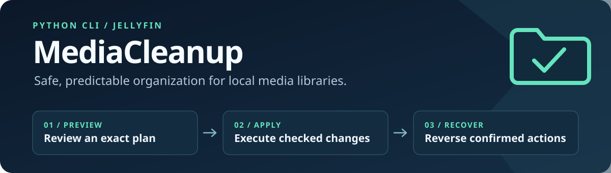
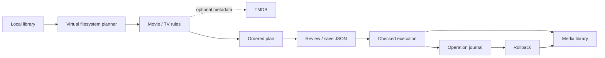

# MediaCleanup



[](https://github.com/frimpongemanuele/MediaCleanup/actions/workflows/ci.yml)

[](LICENSE)

**A safety-first Python CLI for organizing local movie and TV libraries for Jellyfin.**

MediaCleanup turns inconsistent filenames and folders into a structured library. It previews every filesystem operation, optionally enriches titles with TMDB metadata, and records confirmed changes in a journal that can be used to reverse them.

## Why MediaCleanup?

Bulk renaming a library by hand is tedious, but indiscriminate automation risks moving the wrong files. MediaCleanup separates deciding what should change from executing those changes.

| Capability | What it does |
| --- | --- |
| Media organization | Classifies incoming movie and TV folders, normalizes titles and organizes episodes into seasons. |
| Metadata enrichment | Optionally matches movies and TV series against TMDB, including English and Italian title variants. |
| Safe-by-default preview | Builds an in-memory model of the file tree and displays the exact ordered changes before touching the library. |
| Saved plans | Replays a reviewed JSON plan without performing new metadata lookups. |
| Recovery journal | Records completed renames and directory creations so confirmed operations can be reversed. |
| Collision and path checks | Checks source identities and destination availability; does not follow linked directories. |

## Get started

Requirements: **Python 3.10 or newer**, Git, and a local folder containing media you are authorized to manage. A TMDB API key is optional.

Clone and install locally (preferably in a virtual environment):

```sh
git clone https://github.com/frimpongemanuele/MediaCleanup.git
cd MediaCleanup
python -m pip install .
media-cleanup --help
```

You can also run `python -m media_cleanup` or `python movie_cleanup.py` from the checkout. The original V1 script is retained for historical reference; use the modern CLI for plans and journals.

## Try it with synthetic files

No video or API key is needed. This demo creates small placeholder files in a **new** directory, not your actual library. Make sure `TMDB_API_KEY` is unset for the demo (in PowerShell, set `$env:TMDB_API_KEY = ""`; in Bash, run `unset TMDB_API_KEY`).

```sh
# Create disposable movie and TV fixtures.
python examples/create_demo.py demo-library

# Preview and save the exact plan; the media tree does not change.
media-cleanup demo-library --plan-out media-cleanup-plan-demo.json

# Apply the reviewed plan and save an operation journal.
media-cleanup demo-library --apply-plan media-cleanup-plan-demo.json --journal media-cleanup-journal-demo.jsonl
```

Before:

```text
demo-library/
├── Aurora.Bridge.2020/
│   ├── Aurora.Bridge.2020.[ENG].1080p.mkv
│   └── Aurora.Bridge.2020.[ENG].srt
└── Example.Show/
    ├── Example.Show.S01E01.mkv
    └── Example.Show.S01E02.mkv
```

After applying the 11-operation plan:

```text
demo-library/
├── 0_Movies/
│   └── Aurora Bridge (2020)/
│       ├── Aurora Bridge (2020) - English.mkv
│       └── Aurora Bridge (2020).en.srt
└── 0_Shows/
    └── Example Show/
        └── Season 01/
            ├── Example Show S01E01.mkv
            └── Example Show S01E02.mkv
```

Reverse the confirmed changes:

```sh
media-cleanup demo-library --rollback media-cleanup-journal-demo.jsonl
```

On this fixture, the rollback restores the original directory tree and file contents. These names and file contents are synthetic; the placeholders are not playable media.

## Use with a real library

Back up important files first, run against a copy, and review the full operation list. For example, on Windows:

```powershell
# Preview the first 20 top-level folders.
media-cleanup "D:\Media" --batch-size 20 --plan-out media-cleanup-plan.json

# Execute exactly the saved plan.
media-cleanup "D:\Media" --apply-plan media-cleanup-plan.json --journal media-cleanup-journal.jsonl

# If needed, undo confirmed operations.
media-cleanup "D:\Media" --rollback media-cleanup-journal.jsonl
```

Keep plan and journal files outside the selected media directory, and use new filenames for later runs. They contain filenames and filesystem information and should not be shared or committed.

For a single movie or show, add `--single` when creating, applying or rolling back its plan. If the folder was renamed, supply its **original** path for rollback.

`--apply` builds and executes a plan immediately. For important libraries, prefer reviewing and replaying a saved plan instead.

Other options: `--batch-start` chooses the starting index, `--batch-size` controls how many top-level folders are included, and `--journal` selects the journal location. After a batch moves folders into their destination libraries, re-plan from the new list (usually starting at zero). `0_Movies` and `0_Shows` are excluded from incoming-folder selection.

## Optional TMDB configuration

To use metadata enrichment, provide your own API key through the `TMDB_API_KEY` environment variable.

```powershell
# PowerShell 7.2+: input is masked and not written as a literal command.
$env:TMDB_API_KEY = Read-Host "TMDB API key" -MaskInput
```

```bash
# Bash
read -rs -p "TMDB API key: " TMDB_API_KEY; echo
export TMDB_API_KEY
```

Obtain a key from [TMDB's developer portal](https://developer.themoviedb.org/docs/getting-started). The CLI does not automatically load `.env` files. Do not commit or log credentials.

With a key, preview may send inferred titles to TMDB. Without one, MediaCleanup uses local filename heuristics; ambiguous titles can require manual review. Applying a saved plan and rolling back do not call TMDB.

## Architecture



The naming rules, metadata client, library routing, planning and execution are separated so they can be maintained and tested independently. See [the architecture and design decisions](docs/architecture.md) for the module map, safety invariants and limitations.

## Safety and limitations

- No media changes occur during preview. Apply uses filesystem identity and destination checks; it stops on unexpected changes.
- Rollback reverses confirmed operations in reverse order and will not remove a nonempty directory or overwrite a recreated path.
- The journal is not a transaction, and a process interruption mid-operation may require manual inspection. It is not a replacement for backups.
- Do not run while other applications or users are moving files in the same library. Cross-filesystem moves and all possible library layouts are not supported.
- Filename matching is heuristic. Review ambiguous titles, language labels and episode numbers before applying.

Read the [security and privacy guide](SECURITY.md) before using the tool on valuable data.

## Development

```sh
python -m pip install .
python -m unittest discover -v
python -m pip wheel --no-deps --wheel-dir dist .
```

Tests use synthetic media, temporary folders and mocked API responses. CI runs on Windows and Linux, builds the package, and exercises the demo workflow. See [CONTRIBUTING.md](CONTRIBUTING.md).

## Credits and license

Developed by [Emanuele Frimpong](https://github.com/frimpongemanuele). Licensed under the [MIT License](LICENSE).

Designed for use with [Jellyfin](https://jellyfin.org/); this is an independent project and is not affiliated with Jellyfin.

<a href="https://www.themoviedb.org"></a>

**This product uses the TMDB API but is not endorsed or certified by TMDB.**

TMDB supplies optional film and television metadata. Its data, logo and API are subject to TMDB's own [terms and attribution requirements](https://developer.themoviedb.org/docs/faq); the MIT License applies to the MediaCleanup source code.
