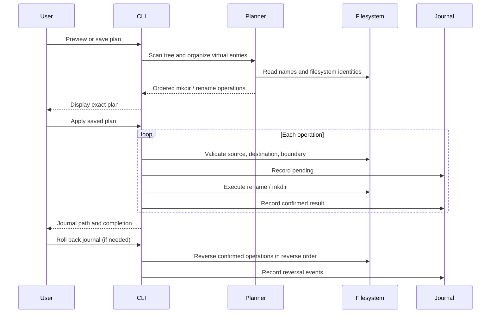

# Architecture and design decisions

MediaCleanup is designed around a simple rule: **deciding what should change must be separate from changing it.** The same ordered plan drives preview and execution.

## Components

| Component | Responsibility |
| --- | --- |
| `media_cleanup/cli.py` | Parse command-line options; build, display, save, replay and roll back plans. |
| `media_cleanup/organizer.py` | Select batches and route incoming folders to movie or TV libraries. |
| `media_cleanup/movies.py` | Infer movie identity, group versions, normalize subtitles and create review folders. |
| `media_cleanup/shows.py` | Identify TV series and normalize season and episode structure. |
| `media_cleanup/naming.py` | Filename normalization, title aliases, language heuristics and episode parsing. |
| `media_cleanup/tmdb.py` | Optional metadata searches and localization; redact exception details. |
| `media_cleanup/media_files.py` | File classification, collision naming and shared planned operations. |
| `media_cleanup/filesystem.py` | In-memory tree, ordered operations and serialized plan format. |
| `media_cleanup/execution.py` | Revalidate and execute operations; durably record journal events; reverse completed changes. |
| `filesystem_safety.py` | Enforce the selected filesystem boundary and reject link-like components. |

The legacy `movie_cleanup.py` filename remains a compatibility entry point to the modern CLI. `movie_cleanup_V1.py` is retained for historical reference and does not use the new planning and recovery workflow.

## Plan and apply lifecycle

### Design choices

- **Virtual tree, not a filesystem copy.** Planning snapshots metadata and topology, simulates directory moves, and reserves chosen destination names. File contents are not copied or read for matching.
- **Replay instead of recalculation.** A saved plan is versioned JSON and contains the exact paths and source identities. Replaying it avoids fresh metadata lookups, which might produce different answers.
- **Identity checks.** Before each rename, the executor checks the source's device and inode identity and checks that the destination is free. This detects many stale or changed paths but is not a content hash.
- **Explicit boundaries.** Library operations remain inside the selected root. Single-folder mode permits a sibling rename of the selected root; subsequent operations are scoped to the renamed folder. Link-like entries are not traversed.
- **Journal before and after execution.** Each operation is recorded as pending before mutation, then confirmed with the resulting identity. Journal records are flushed to disk. A rollback reverses confirmed actions and records each reversal.
- **Conservative failure.** If a destination appears, a scope check fails or an existing source cannot be verified, execution stops. Rollback refuses ambiguous interrupted records, changed paths and nonempty created folders.

## Trust boundaries

| Data | Handling |
| --- | --- |
| Filenames and paths | Treated as local input; sanitized and validated before writes. |
| TMDB results | Optional external metadata; used as suggestions, not assumed to be correct descriptions of media contents. |
| API key | Read from the environment; raw request exceptions are not printed. |
| Plans and journals | Local files containing absolute paths and filesystem identities; keep private, apply only files you generated and reviewed. |

## Limitations and future work

- The virtual tree is held in memory; extremely large libraries may need a more scalable scan and planning strategy.
- Filesystem operations are not atomic as a group. The journal is not cryptographically authenticated; do not edit it or treat it as a trusted record from another machine.
- Interruption between mutation and confirmation requires manual inspection. Backups are still necessary.
- Metadata matching and language detection are heuristic and depend on filenames, not audio or video analysis.
- Concurrent changes and cross-device renames are outside the supported workflow.

## Validation approach

`test_security.py` covers path boundaries, credential-safe errors and basic behavior. `test_plan.py` covers preview, saved-plan replay, collision handling, stale paths, partial apply failures, rollback safety, and synthetic movie and television workflows. No real media or live TMDB key is needed.
